# Detección temprana de riesgo académico en Pensamiento Cuantitativo

**Proyecto de graduación 2026 · Universidad del Valle de Guatemala**

| | |
|---|---|
| **Autor** | Pedro Pablo Guzmán Mayen |
| **Carné** | 22111 |
| **Carrera** | Ingeniería en Ciencia de la Computación y Tecnologías de la Información |
| **Asesor(a)** | Lynette García Pérez |

---

## Descripción

Herramienta de aprendizaje automático que identifica, desde los primeros meses del semestre, a los estudiantes en riesgo de reprobar el curso **Pensamiento Cuantitativo**. A partir del historial de actividades exportado de Canvas (2019–2022) y de la información de ingreso de cada estudiante, se entrenó un modelo por mes (enero a abril) que estima la probabilidad de reprobar con la información disponible **hasta ese momento**, para que el personal docente pueda intervenir a tiempo.

El proyecto incluye:

1. **Limpieza** del registro de estudiantes y de más de 60,000 registros de actividades.
2. **Extracción de características** mensuales (porcentaje acumulado en actividades, notas de parciales, entregas tardías, etc.).
3. **Análisis exploratorio** con pruebas estadísticas para seleccionar variables.
4. **Entrenamiento y comparación** de 5 algoritmos × 4 meses, en clasificación (aprueba/reprueba) y regresión (nota final).
5. Una **aplicación web** (Gradio) en la que se suben dos archivos CSV y se obtiene la lista de estudiantes en riesgo.

## Resultados principales

La aplicación usa **Random Forest**. Desempeño en el conjunto de prueba (349 estudiantes, 48 reprobados) para la clase *reprobado*:

| Información hasta | Recall (reprobados detectados) | Precisión | F2 | PR-AUC |
|---|---|---|---|---|
| Enero | 0.896 | 0.705 | 0.850 | 0.842 |
| Febrero (1.er parcial) | 0.917 | 0.815 | 0.894 | 0.951 |
| Marzo (2.º parcial) | 1.000 | 0.814 | 0.956 | 0.978 |
| Abril (3.er parcial) | 1.000 | 0.960 | 0.992 | 0.987 |

- Con la información de **enero** ya se detecta a ~9 de cada 10 estudiantes que terminarán reprobando.
- Las variables más importantes son el **porcentaje acumulado en actividades** y el **número de intento** del curso.
- La comparación completa de los 5 algoritmos está al final de [`src/scripts/modelos/modelos.ipynb`](src/scripts/modelos/modelos.ipynb).

## Tecnologías

| Área | Herramientas |
|---|---|
| Lenguaje | Python 3.10 |
| Datos | pandas, NumPy, pyreadr, openpyxl |
| Estadística | SciPy, statsmodels |
| Visualización | Matplotlib, seaborn |
| Modelado | scikit-learn, LightGBM, XGBoost, Optuna |
| Aplicación | Gradio |
| Entorno | Jupyter Notebook |

## Estructura del repositorio

```
2026-22111-guzman-mayen-pedro-pablo/
├── capturas/                     # Capturas de pantalla del sistema
├── demo/
│   └── demo.mp4                  # Video demostrativo
├── docs/
│   ├── informe_final.pdf
│   └── consentimiento_firmado.pdf
├── src/
│   ├── .env.example              # Variables de entorno (opcionales, solo Gradio)
│   ├── requirements.txt          # Dependencias con versiones exactas
│   ├── Datos/                    # Datos de entrada (NO se incluyen, ver README interno)
│   └── scripts/
│       ├── limpieza/             # 1. Limpieza del registro y de las actividades
│       ├── feature_extraction/   # 2. Construcción de características mensuales
│       ├── exploratorio/         # 3. Análisis exploratorio y división de datos
│       │   └── figuras/          #    Todas las figuras del análisis exploratorio
│       ├── modelos/              # 4. Entrenamiento, resultados y gráficas
│       └── app/                  # 5. Aplicación web (Gradio) y modelos finales
└── README.md
```

## Flujo de trabajo

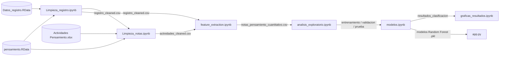

Cada notebook empieza con una tabla de entradas/salidas y un **resumen de las decisiones tomadas y su justificación**. Los notebooks deben ejecutarse en este orden:

| # | Notebook | Qué hace |
|---|---|---|
| 1 | [`limpieza/Limpieza_registro.ipynb`](src/scripts/limpieza/Limpieza_registro.ipynb) | Limpia el registro de estudiantes: tipos de dato, rangos, faltantes, estudiante de prueba de Canvas y reconstrucción de los intentos de los repitentes. |
| 2 | [`limpieza/Limpieza_notas.ipynb`](src/scripts/limpieza/Limpieza_notas.ipynb) | Limpia las actividades año por año contra la planificación oficial, elimina duplicados, imputa actividades faltantes y calcula entregas tardías. |
| 3 | [`feature_extraction/feature_extraction.ipynb`](src/scripts/feature_extraction/feature_extraction.ipynb) | Construye las características mensuales acumuladas por estudiante. |
| 4 | [`exploratorio/analisis_exploratorio.ipynb`](src/scripts/exploratorio/analisis_exploratorio.ipynb) | Divide los datos (70/15/15) y analiza, solo con entrenamiento, qué variables se relacionan con el resultado (Mann-Whitney, V de Cramér, Kruskal-Wallis, VIF). |
| 4b | [`exploratorio/exploratorio.ipynb`](src/scripts/exploratorio/exploratorio.ipynb) | Figuras descriptivas complementarias para el informe. |
| 5 | [`modelos/modelos.ipynb`](src/scripts/modelos/modelos.ipynb) | Entrena y evalúa 5 algoritmos por mes con Optuna (clasificación y regresión). |
| 6 | [`modelos/graficas_resultados.ipynb`](src/scripts/modelos/graficas_resultados.ipynb) | Gráficas comparativas e importancia de variables. |
| 7 | [`app/data/generacion_prueba.ipynb`](src/scripts/app/data/generacion_prueba.ipynb) | Genera los CSV de prueba para la aplicación a partir del conjunto de prueba. |

## Datos

Los datos **no se incluyen** en el repositorio porque contienen registros académicos de estudiantes. En [`src/Datos/README.md`](src/Datos/README.md) se describen los archivos necesarios, su contenido y dónde colocarlos para reproducir el proyecto. Los resultados ya calculados (métricas, importancias, figuras y modelos entrenados) sí están incluidos, por lo que la aplicación se puede ejecutar sin volver a entrenar. Para obtener los datos originales, contactarse con Lynette García Pérez, asesora del proyecto, al siguiente correo electrónico (lgarciap@uvg.edu.gt)

## Instalación

Requisitos: **Python 3.10** y `pip`.

```bash
git clone https://github.com/GraduacionesUVG/2026-22111-guzman-mayen-pedro-pablo.git
```

```bash
cd 2026-22111-guzman-mayen-pedro-pablo/src
```

```bash
python3.10 -m venv .venv
```

```bash
source .venv/bin/activate
```

En Windows, el comando para activar el entorno es `.venv\Scripts\activate`.

```bash
pip install -r requirements.txt
```

Opcional, para cambiar el puerto o la dirección de la aplicación:

```bash
cp .env.example .env
```

## Uso

### Aplicación web

```bash
cd scripts/app
```

```bash
python app.py
```

Abre `http://127.0.0.1:7860` en el navegador y:

1. Elige el **mes** hasta el cual quieres evaluar el riesgo (enero a mayo; para mayo se usa el modelo de abril).
2. Sube el CSV de **información general** de los estudiantes.
3. Sube el CSV de **actividades** de los estudiantes.
4. Presiona **Predecir**. Se muestra cada estudiante con su probabilidad de reprobar y la clasificación *En riesgo* / *Fuera de riesgo*, ordenados de mayor a menor riesgo.
5. Descarga los resultados con **Exportar resultados (CSV)**.

Para probarla se pueden usar los archivos `registro_prueba_herramienta.csv` y `notas_prueba_herramienta.csv` que genera `generacion_prueba.ipynb`.

#### Formato de los archivos de entrada

Ambos archivos deben estar en UTF-8 y separados por comas. Los textos (colegio, título y nombre de actividad) deben ir en **mayúsculas y sin tildes**, igual que en los datos de entrenamiento.

**Información general** (una fila por estudiante):

| Columna | Tipo | Descripción |
|---|---|---|
| `Est_ID` | número | Identificador único de cada estudiante (anonimizado) |
| `Anio` | entero | Año en el que el estudiante lleva el curso |
| `PAA` | número | Nota obtenida en el examen de admisión PAA (200–1600) |
| `Colegio` | texto | Institución de nivel medio de la que proviene el estudiante |
| `TituloNivelMedio` | texto | Título de nivel medio obtenido por el estudiante |
| `veces_curso` | entero | Número de veces que el estudiante ha tomado el curso, incluida la actual |

**Actividades** (una fila por actividad por estudiante):

| Columna | Tipo | Descripción |
|---|---|---|
| `Est_ID` | número | Identificador único del estudiante; debe coincidir con el archivo de información general |
| `Anio` | entero | Año en el que se realizó la actividad |
| `Seccion` | texto/entero | Sección del curso a la que pertenece el estudiante |
| `Actividad` | texto | Nombre de la actividad realizada. Los exámenes deben llamarse `PARCIAL 1` … `PARCIAL 4` o `EXAMEN FINAL` |
| `NotaPtos` | número | Nota obtenida por el estudiante en puntos netos |
| `PuntosPosibles` | número | Cantidad máxima de puntos obtenibles en la actividad |
| `FechaVencimiento` | fecha `YYYY-MM-DD` | Fecha en la que la actividad se cierra por completo y deja de estar disponible para entrega |
| `FechaTodoElDia` | fecha `YYYY-MM-DD` | Fecha de entrega de la actividad (puede ir vacía) |
| `FechaCalificacion` | fecha `YYYY-MM-DD` | Fecha en la que la actividad fue calificada (puede ir vacía) |
| `FechaEnvio` | fecha `YYYY-MM-DD` | Fecha en la que el estudiante entregó la actividad (vacía si no entregó) |

Las cuatro columnas de fecha deben existir aunque tengan celdas vacías. Ambos archivos pueden traer otras columnas del registro original; la herramienta solo usa las de estas tablas. El significado de todas las variables originales está en el [diccionario de variables](src/Datos/README.md#diccionario-de-variables-de-los-conjuntos-originales).

### Notebooks

Con el entorno activado y los datos en `src/Datos/`:

```bash
jupyter notebook scripts/
```

Ejecuta los notebooks en el orden de la tabla de [Flujo de trabajo](#flujo-de-trabajo). El entrenamiento (`modelos.ipynb`) usa 1,000 *trials* de Optuna por modelo y mes, por lo que puede tardar varias horas.

## Capturas

Las capturas se tomaron con la aplicación ejecutándose sobre los datos del conjunto de prueba (`registro_prueba_herramienta.csv` y `notas_prueba_herramienta.csv`, 349 estudiantes). Los `Est_ID` son identificadores anonimizados.

### Uso de la aplicación

| | |
|---|---|
| 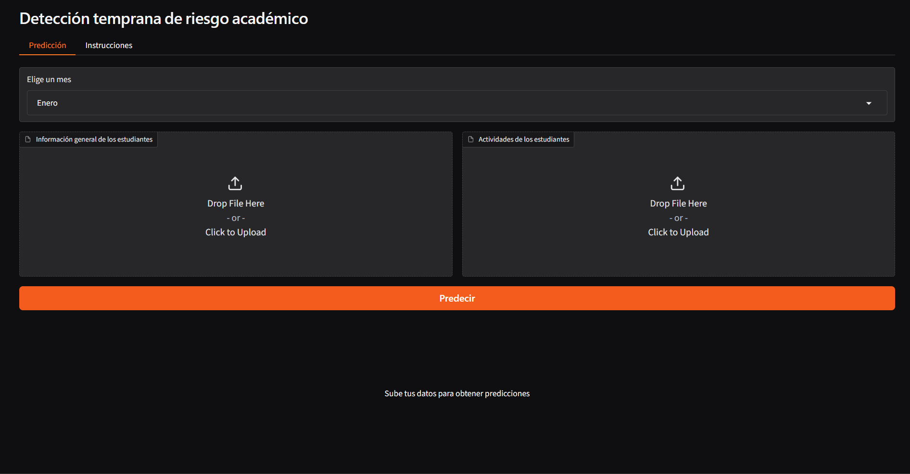 | **1. Pantalla inicial.** Pestaña *Predicción* con el selector de mes, las dos áreas para cargar los archivos CSV y el mensaje *"Sube tus datos para obtener predicciones"*, que se muestra mientras no hay resultados. |
| 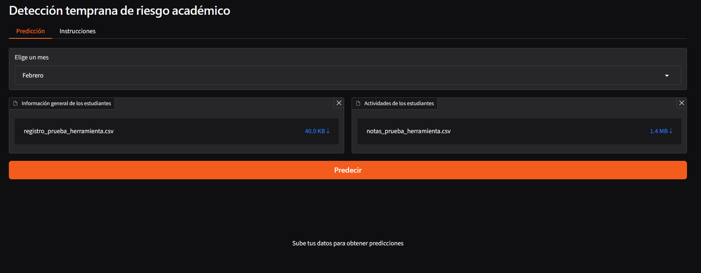 | **6. Archivos cargados.** Se eligió el mes de febrero y se subieron el archivo de información general (`registro_prueba_herramienta.csv`) y el de actividades (`notas_prueba_herramienta.csv`), justo antes de presionar *Predecir*. |
| 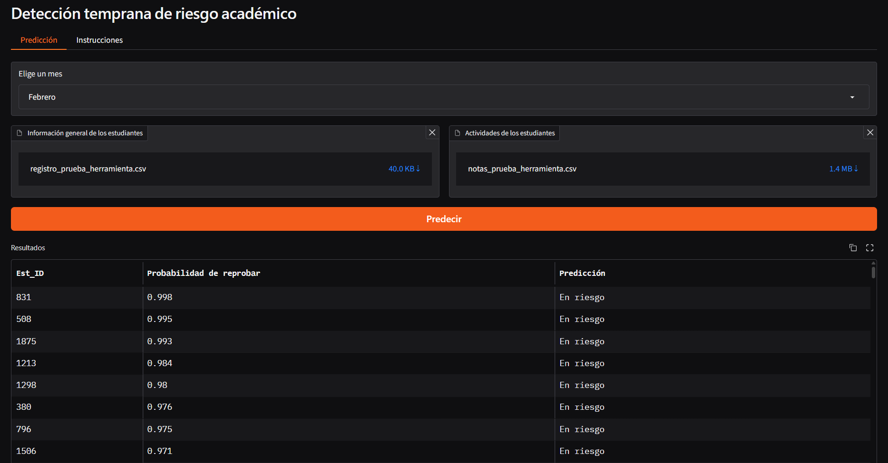 | **7. Resultados con información hasta febrero.** Al predecir, el mensaje inicial se reemplaza por la tabla de resultados: cada estudiante con su probabilidad de reprobar y la clasificación *En riesgo* / *Fuera de riesgo*, ordenados de mayor a menor riesgo. |
| 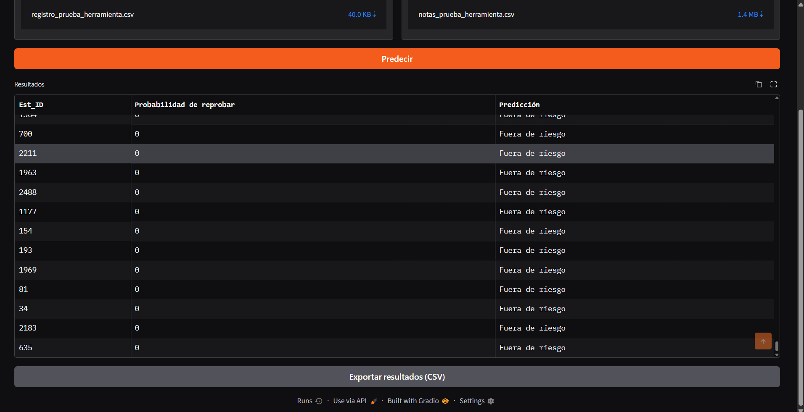 | **8. Final de la tabla de resultados.** Estudiantes con probabilidad cercana a 0, clasificados *Fuera de riesgo*, y el botón *Exportar resultados (CSV)*, que aparece después de predecir. |
| 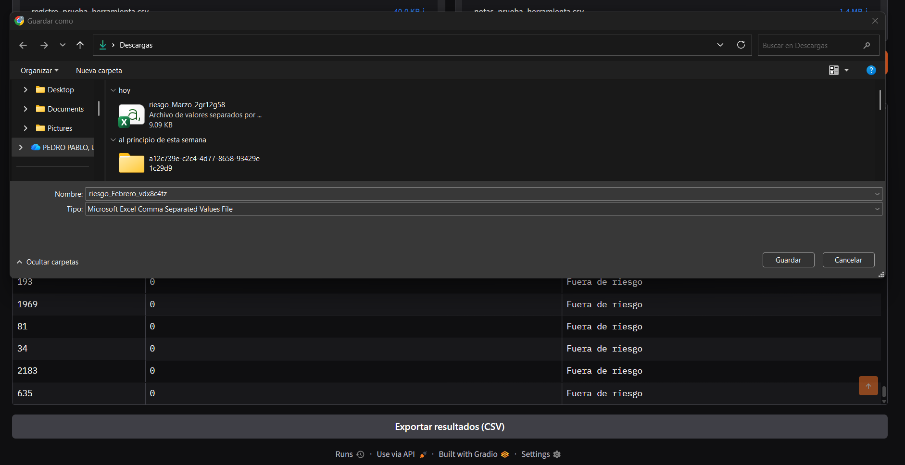 | **9. Exportación de resultados.** Al presionar *Exportar resultados (CSV)* el navegador descarga el archivo `riesgo_<mes>_<id>.csv`. |
| 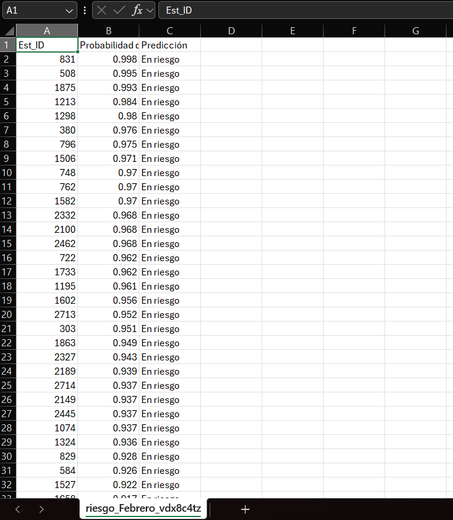 | **10. Archivo exportado.** El CSV abierto en Excel con las columnas `Est_ID`, `Probabilidad de reprobar` y `Predicción`, listo para compartir con el personal docente. |

### Instrucciones dentro de la aplicación

| | |
|---|---|
| 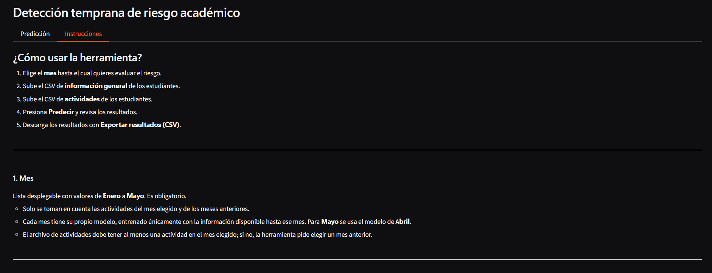 | **2. Cómo usar la herramienta.** Pestaña *Instrucciones* con los cinco pasos de uso y las reglas del selector de mes: solo se usan actividades hasta el mes elegido y para mayo se usa el modelo de abril. |
| 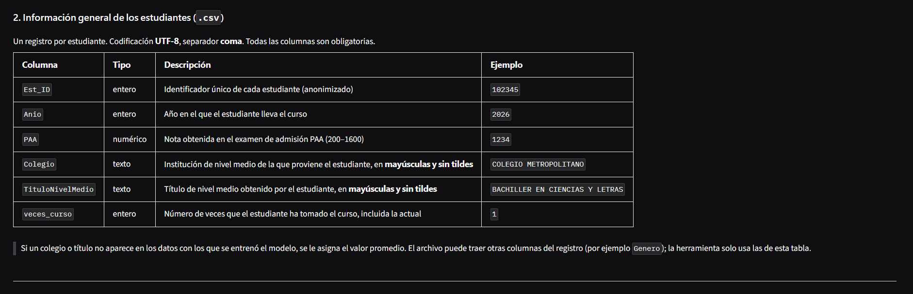 | **3. Formato del archivo de información general.** Columnas obligatorias (`Est_ID`, `Anio`, `PAA`, `Colegio`, `TituloNivelMedio`, `veces_curso`) con su tipo, descripción y ejemplo. |
| 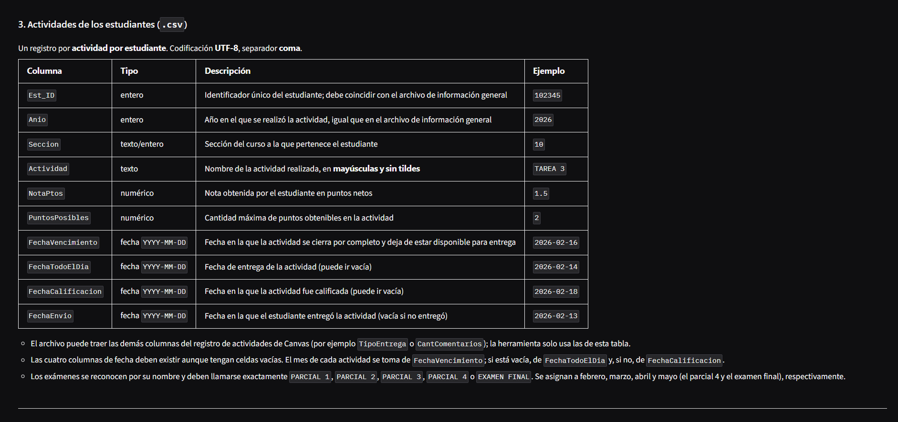 | **4. Formato del archivo de actividades.** Columnas obligatorias, reglas para las fechas y nombres exactos que deben tener los exámenes (`PARCIAL 1` … `PARCIAL 4`, `EXAMEN FINAL`). |
| 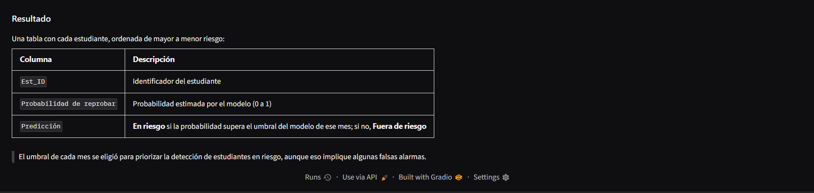 | **5. Descripción del resultado.** Significado de cada columna de la tabla de resultados y criterio del umbral, que prioriza detectar a los estudiantes en riesgo. |

### Resultados de los modelos

| | |
|---|---|
| 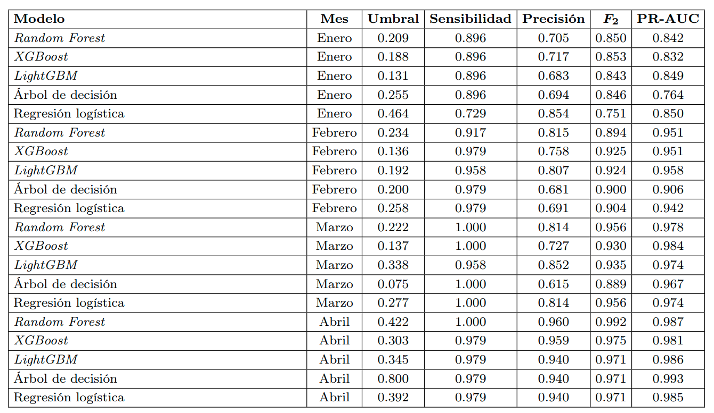 | **11. Comparación de los modelos de clasificación.** Umbral de decisión, sensibilidad, precisión, F2 y PR-AUC de la clase *reprobado* en el conjunto de prueba, para los cinco algoritmos y los cuatro meses. La aplicación usa Random Forest. |
| 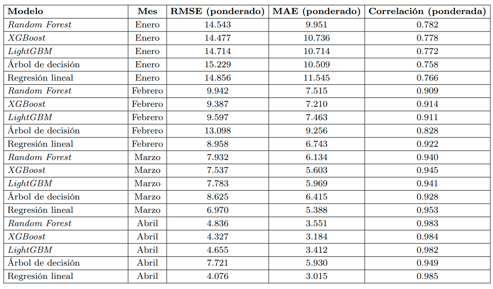 | **12. Modelos de regresión de la nota final.** RMSE, MAE y correlación ponderados para los cinco algoritmos y los cuatro meses. |

## Demostración y documentos

- Video demostrativo: [`demo/demo.mp4`](demo/demo.mp4)
- Informe final: [`docs/informe_final.pdf`](docs/informe_final.pdf)
- Figuras del análisis exploratorio: [`src/scripts/exploratorio/figuras/`](src/scripts/exploratorio/figuras/)
- Figuras de resultados de los modelos: [`src/scripts/modelos/figuras/`](src/scripts/modelos/figuras/)
